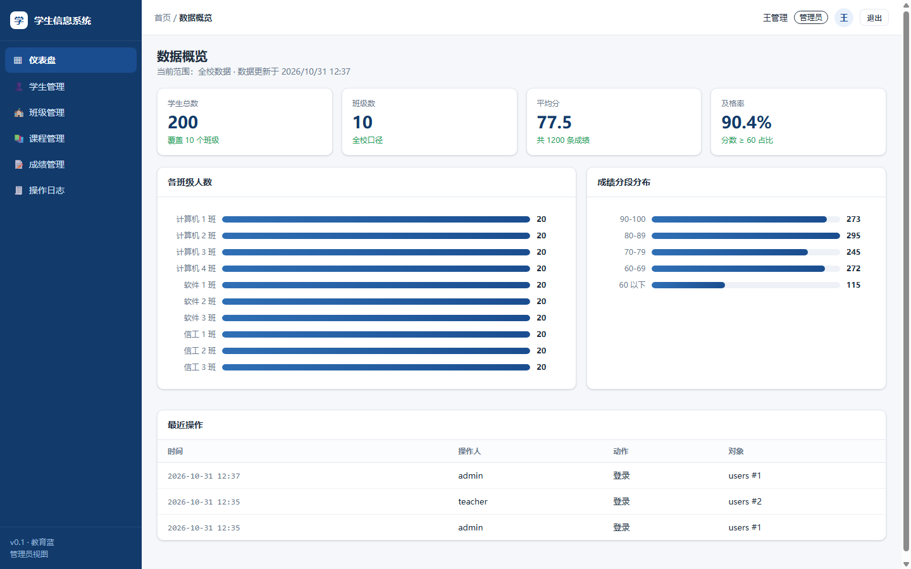
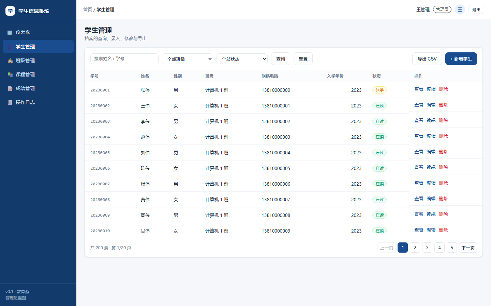

# 学生信息管理系统（SIS · 课程作业 / 毕业设计级）

一个可以真跑起来的学校学生信息管理后台：学生档案、班级院系、课程、成绩、统计图表、CSV 导出、操作日志，带登录与两种角色权限。

界面是「左侧导航 + 卡片仪表盘」的教育蓝风格，纯前端原生 JS，无构建步骤，`npm start` 一条命令启动。



## 快速开始

```bash
npm install      # 只装 3 个纯 JS 依赖，无需编译原生模块
npm start        # 首次启动会自动建表并灌入演示数据
```

Windows 用户也可以直接双击项目根目录的 **`启动系统.bat`**：它会检查 Node.js、首次自动装依赖、启动服务并打印访问地址。要清空重来时双击 **`重置演示数据.bat`**（会二次确认，且检测到服务还在运行时拒绝执行）。

浏览器打开 <http://localhost:3000>，用下面的账号登录：

| 账号 | 密码 | 角色 | 能看到什么 |
| --- | --- | --- | --- |
| `admin` | `123456` | 管理员 | 全部院系 / 班级 / 200 名学生 / 1200 条成绩 / 操作日志 |
| `teacher` | `123456` | 教师（计算机 1 班班主任） | 只有本班 20 名学生与本班成绩，无操作日志入口 |

演示数据：3 个院系、10 个班级、200 名学生、6 门课程、1200 条成绩。想恢复初始数据：

```bash
rm -f school.db school.db-wal school.db-shm   # 删库
npm run seed                                  # 重新生成
```

## 功能清单

| 模块 | 能力 |
| --- | --- |
| 登录与权限 | JWT 登录，密码 bcrypt 加密入库；管理员 / 教师两种角色；教师的数据范围由所在班级决定 |
| 仪表盘 | 学生数、班级数、平均分、及格率 4 张卡 + 各班级人数分布 + 成绩分段分布 + 最近操作 |
| 学生管理 | 列表分页、按姓名/学号搜索、按班级/学籍状态筛选、新增、编辑、删除（软删除）、详情含成绩单、导出 CSV |
| 班级管理 | 班级列表（含班主任、学生数）、新增、编辑、删除；改班主任时自动同步该教师的数据范围 |
| 课程管理 | 课程编码/名称/学分维护；编码唯一；有成绩的课程不允许删除 |
| 成绩管理 | 按班级/课程/学期筛选、录入、改分、删除；同一学生同一课程同一学期同一考试类型只能一条；分数段统计 |
| 操作日志 | 登录、新增、修改、删除、导出全部留痕（谁、何时、改了什么、IP） |



## 技术栈

| 层 | 选型 | 为什么 |
| --- | --- | --- |
| 前端 | 原生 HTML + CSS + ES Module，无框架无构建 | 改一行刷新就生效，小白也能看懂每个文件 |
| 后端 | Node.js + Express 4 | 生态最稳，路由代码短，报错信息友好 |
| 数据库 | SQLite（Node 内置 `node:sqlite`） | 单文件、免安装、免编译；SQL 是标准语法，换 MySQL 只改驱动 |
| 认证 | jsonwebtoken + bcryptjs | 业界通用做法，代码量小 |
| 图表 | 纯 CSS 条形图 | 不引第三方库，断网也能跑 |

> 与最初设计的两处偏差（已实测）：
> 1. 数据库驱动用 Node 内置 `node:sqlite` 替代 `better-sqlite3` —— 省掉 Windows 上的原生模块编译，只装 3 个纯 JS 包。要求 Node ≥ 22.5。
> 2. 图表用 CSS 条形图替代 Chart.js —— 少一个 CDN 依赖，离线可用。
> 详细设计见 `docs/superpowers/specs/2026-10-31-student-info-management-design.md`。

## 目录结构

```
server/                 后端
  index.js              入口：建表 → 空库自动灌数据 → 挂路由 → 静态托管
  config.js             端口、JWT 密钥、数据库路径
  db/schema.sql         7 张表 + 8 个索引
  db/index.js           node:sqlite 连接、事务封装
  db/seed.js            演示数据生成（固定随机种子，可重复）
  middleware/           auth（认证+角色+数据范围）、audit（写日志）、error（统一错误）
  routes/               auth / students / classes / departments / courses / scores / audit / stats / users
  utils/                http（统一响应）、validate（参数校验）、csv（带 BOM 导出）
public/                 前端
  login.html            登录页
  index.html            仪表盘
  students.html         学生管理（重点页）
  classes.html          班级管理
  courses.html          课程管理
  scores.html           成绩管理
  audit.html            操作日志（仅管理员）
  assets/js/api.js      请求封装（自动带 token、401 跳登录）
  assets/js/auth.js     登录态与当前用户
  assets/js/ui.js       侧栏、顶栏、分页、条形图、弹窗、toast 等公共组件
test/api.test.mjs       16 条接口测试（独立临时库，不污染演示数据）
scripts/check-syntax.mjs 前端脚本语法自检
scripts/browser-check.mjs 真浏览器端到端自检（headless Chrome/Edge，13 项）
docs/                   设计文档、接口文档、使用手册、截图
```

## 验证命令（都是真实跑过的）

```bash
npm test                  # 16/16 通过：登录、权限、分页、搜索、增删改、唯一约束、CSV BOM、日志
npm run check:syntax      # 7 个页面 + 3 个模块语法检查
npm run check:ui          # 真浏览器跑一遍：登录跳转、仪表盘、列表、搜索、弹窗、教师范围
```

`check:ui` 需要本机装有 Chrome 或 Edge，会以 headless 模式启动、跑完自动关闭，并把截图写到 `docs/screenshots/`。

## 接口一览

统一响应：`{ "code": 0, "message": "ok", "data": ... }`；出错时 HTTP 状态码 + `{ code, message }`。

| 方法 | 路径 | 说明 | 权限 |
| --- | --- | --- | --- |
| POST | `/api/auth/login` | 登录，返回 token 与用户信息 | 公开 |
| GET | `/api/auth/me` | 当前登录用户 | 登录 |
| POST | `/api/auth/logout` | 退出（记日志） | 登录 |
| GET | `/api/students` | 学生列表（`page` `pageSize` `keyword` `classId` `status`） | 登录 |
| GET | `/api/students/export` | 导出 CSV | 登录 |
| GET | `/api/students/:id` | 学生详情（含成绩） | 登录 |
| POST | `/api/students` | 新增学生 | 登录 |
| PUT | `/api/students/:id` | 修改学生 | 登录 |
| DELETE | `/api/students/:id` | 删除学生（软删除） | 登录 |
| GET/POST/PUT/DELETE | `/api/classes` `/api/classes/:id` | 班级维护 | 删改仅管理员 |
| GET/POST/PUT/DELETE | `/api/departments` `/api/courses` | 院系 / 课程维护 | 删改仅管理员 |
| GET | `/api/scores` | 成绩列表 | 登录（教师限本班） |
| GET | `/api/scores/stats` | 成绩统计与分数段 | 登录（教师限本班） |
| POST/PUT/DELETE | `/api/scores` `/api/scores/:id` | 成绩录入 / 改分 / 删除 | 登录（教师限本班） |
| GET | `/api/stats/overview` | 仪表盘概览 | 登录（教师本班口径） |
| GET | `/api/audit-logs` | 操作日志 | 仅管理员 |
| GET | `/api/users` | 账号列表（选班主任用） | 仅管理员 |
| GET | `/api/health` | 健康检查 | 公开 |

完整的请求体与返回示例见 [docs/api.md](docs/api.md)。

## 已知限制（演示项目，别直接上生产）

- 数据库是本地 SQLite 单文件，只适合单机演示；并发大或多实例部署要换 MySQL / PostgreSQL。
- token 存在 `localStorage`，没有做 HttpOnly Cookie + CSRF 那套；演示够用，生产要改。
- 没有 HTTPS、没有刷新 token、没有登录失败次数限制。
- 学生端、家长端、选课、排课、缴费不在范围内（见设计文档第 1 节）。
- JWT 密钥写在 `server/config.js` 的默认值里，部署前务必用环境变量 `JWT_SECRET` 覆盖。

## 文档

- 设计文档：`docs/superpowers/specs/2026-10-31-student-info-management-design.md`
- 实施计划：`docs/superpowers/plans/2026-10-31-student-info-management.md`
- 接口文档：[docs/api.md](docs/api.md)
- 使用手册（给不懂技术的老师看的）：[docs/manual.md](docs/manual.md)
